<div align="center">

# 🌹 SecureNFT

### *The Enchanted Garden*

*A full-stack Web3 DApp where a soulbound Rose unlocks a hidden garden of Lilies.*

[](./LICENSE)
[](https://docs.soliditylang.org/)
[](https://hardhat.org/)
[](https://react.dev/)
[](https://vitejs.dev/)
[](https://sepolia.etherscan.io/)

</div>

---

<!--
Screenshot slot — drop a screenshot or GIF of the Gate Page / Garden here.
Suggested path: docs/preview.png, then:  
-->

## At a glance

- **NFT-gated access** — an Express server verifies on-chain ownership before the UI unlocks
- **Two tokens, one ERC1155** — ROSE (soulbound access key) + LILY (collectible)
- **Upgradeable** via OpenZeppelin UUPS proxy
- **Deployed on Sepolia testnet** — no mainnet funds needed to try it

---

## What is this project?

SecureNFT is an NFT collection called **My Flowers** — a garden of Rose and Lily NFTs deployed on the Sepolia testnet. The Rose is exclusive (one per wallet) and acts as an access key. Only Rose holders can enter the garden and mint Lilies.

The project was built to learn three specific things in depth:

- **How to build a server-gated frontend** — using an Express server to verify NFT ownership on-chain before granting access to the UI
- **How to create and structure NFT metadata** — writing JSON metadata files and linking them to token IDs so NFT marketplaces can read name, description, and image
- **How to design a Web3 frontend** — building a mystical, animated DApp UI with React, inline SVG, canvas particles, and custom CSS design tokens

---

## Tech stack

| Layer | Technology | Purpose |
|---|---|---|
| Smart Contract | Solidity + Hardhat | ERC1155 NFT with UUPS upgradeable proxy |
| Backend | Node.js + Express | Verify Rose NFT ownership via blockchain query |
| Frontend | React + Vite | Animated DApp UI with wallet connection and minting |
| Blockchain Library | Ethers.js v6 | Used in both frontend and server to talk to the contract |
| Wallet | MetaMask | Signs transactions and provides wallet address |
| Network | Sepolia testnet | Where the contract is deployed |

---

## How the access gate works

```mermaid
flowchart TD
    A[User lands on Gate Page] --> B[Connect MetaMask]
    B --> C[Click &quot;Check Access&quot;]
    C --> D[Frontend POSTs wallet → Express server :3000]
    D --> E[Server calls balanceOf&#40;wallet, 0&#41; on Sepolia]
    E --> F{Rose balance &gt; 0?}
    F -- yes --> G[Access Granted → Garden Page]
    F -- no --> H[No NFT found → Gate stays locked]
```



The server is the gatekeeper. Frontend checks can be bypassed in DevTools — the server cannot be fooled because it reads directly from the blockchain.

---

## Getting started

**1. Clone and install root dependencies (for Hardhat):**
```bash
git clone https://github.com/HopeMabuza/SecureNFT.git
cd SecureNFT
npm install
```

**2. Install frontend dependencies:**
```bash
cd frontend && npm install && cd ..
```

**3. Create your `.env` files** (copy the examples):
```bash
cp .env.example .env
cp frontend/.env.example frontend/.env
```
Then fill in your own `SEPOLIA_RPC_URL`, `PRIVATE_KEY`, and `VITE_CONTRACT_ADDRESS`.

**4. Start the server** (Terminal 1):
```bash
npm run server
# → Server running on http://localhost:3000
```

**5. Start the frontend** (Terminal 2):
```bash
cd frontend && npm run dev
# → http://localhost:5173
```

Open `http://localhost:5173` with MetaMask installed and switched to Sepolia.

---

## User flow

1. Land on the **Gate Page** — dark card with glowing rose emblem
2. Click **Connect Wallet** — MetaMask opens
3. Click **Check Access** — server queries the blockchain
4. **If you own a Rose:** Access granted, the full Enchanted Garden appears
5. **If you don't:** *"No NFT found"* — gate stays locked
6. Inside the garden: choose how many Lilies to mint and send the transaction
7. Your Lily balance updates in the navbar after each mint

---

## Contract details

- **Network:** Sepolia testnet
- **Contract address:** [`0x564A2d245F04b1dBA5B65FCe48920368B4f3C51B`](https://sepolia.etherscan.io/address/0x564A2d245F04b1dBA5B65FCe48920368B4f3C51B)
- **Token IDs:** `0` = ROSE, `1` = LILY
- **ROSE:** 0.01 ETH · max 100 supply · 1 per wallet · soulbound
- **LILY:** 0.005 ETH each · max 10,000 supply · unlimited per wallet
- **Standard:** ERC1155 (multi-token)
- **Upgradeable:** UUPS proxy pattern via OpenZeppelin

---

## Key design decisions

<details>
<summary><strong>Why a server instead of just checking in the frontend?</strong></summary>

Frontend code runs in the browser and can be modified by anyone using DevTools. A user could set a JavaScript variable to `true` and bypass any frontend check. The server calls the blockchain directly and cannot be tricked.
</details>

<details>
<summary><strong>Why ERC1155 instead of ERC721?</strong></summary>

ERC1155 supports multiple token types in a single contract. One contract handles both ROSE (ID 0) and LILY (ID 1) instead of deploying two separate contracts.
</details>

<details>
<summary><strong>Why UUPS upgradeable?</strong></summary>

The contract can be improved after deployment without losing the token balances or the contract address. The proxy stores the state; the implementation can be replaced.
</details>

<details>
<summary><strong>Why extract only the ABI array from Hardhat artifacts?</strong></summary>

Hardhat's full artifact JSON contains bytecode, deployment metadata, and other fields Ethers.js does not need. Ethers.js only accepts a plain array — passing the full artifact causes an *"abi is not iterable"* error.
</details>

---

## What was learned

<details>
<summary>Click to expand the full learning table</summary>

| Topic | What was practiced |
|---|---|
| Solidity ERC1155 | Writing an upgradeable multi-token contract with max supply, soulbound transfers, and payable mint functions |
| NFT Metadata | Structuring JSON metadata files with name, description, image, and attributes linked to token IDs |
| Hardhat | Compiling, deploying, and interacting with contracts via scripts |
| OpenZeppelin Upgrades | Using UUPS proxy pattern |
| Express + Ethers.js (server) | Querying the blockchain from a backend to verify ownership without trusting the browser |
| Server-gated access | Why frontend checks alone are insecure, and how to enforce access with a server |
| CORS | Allowing the frontend (port 5173) to communicate with the backend (port 3000) |
| React + Vite | Component-based frontend with hooks, props, and conditional rendering |
| Ethers.js (frontend) | Connecting MetaMask, reading contract state, and sending transactions |
| CSS design system | CSS variables, glassmorphism, neon glows, keyframe animations |
| Canvas API | Drawing 120 animated sparkle particles with requestAnimationFrame |
| SVG illustration | Building a garden scene with layered SVG elements, radial gradients, and blur filters |

</details>

---

## Project structure

<details>
<summary>Click to expand</summary>

```
SecureNFT/
├── contracts/
│   └── NFT.sol                  — ERC1155 contract: ROSE + LILY, soulbound, UUPS upgradeable
├── scripts/
│   ├── deploy.js                — Deploys the proxy contract to Sepolia
│   ├── interact.js              — Mints tokens and checks balances via script
│   ├── new.js                   — Additional interaction script
│   └── Server.js                — Express server: queries blockchain, returns authorized/denied
├── metadata/
│   ├── images/{0,1}.png         — Images for ROSE (0) and LILY (1)
│   └── jsons/{0,1}.json         — Metadata for ROSE (0) and LILY (1)
├── frontend/
│   └── src/
│       ├── abi/MyContract.json  — ABI array extracted from Hardhat artifact
│       ├── hooks/               — useContract (chain) + useAccess (server)
│       ├── components/          — WalletConnect, ContractReader, ContractWriter, ParticleField
│       ├── pages/               — GatePage + HomePage
│       ├── App.jsx              — Root: renders gate or garden
│       ├── index.css            — Global styles, CSS variables, neon buttons
│       └── main.jsx             — React entry point
├── hardhat.config.js
└── .env.example                 — Template for your secrets (never commit real .env)
```

</details>

---

## NFT metadata

Each token has a metadata JSON file that tells marketplaces what the NFT is:

```json
// metadata/jsons/0.json — The Crimson Rose
{
  "name": "The Crimson Rose",
  "description": "A soulbound rose of eternal flame. Only one may bloom per wallet.",
  "image": "<your-ipfs-or-server-url>/images/0.png",
  "attributes": [
    { "trait_type": "Type", "value": "Rose" },
    { "trait_type": "Rarity", "value": "Exclusive" }
  ]
}
```

Token IDs map to metadata: `tokenURI(0)` returns Rose metadata, `tokenURI(1)` returns Lily metadata.

---

## Roadmap & honest limitations

- No automated test suite yet — core behaviours (mint cap, 1-rose-per-wallet, soulbound transfer revert) would be the first to cover
- Server trusts the `walletAddress` field in the request body; a production version would sign-verify a nonce to prove wallet ownership
- No live demo link yet — runs locally against Sepolia

---

